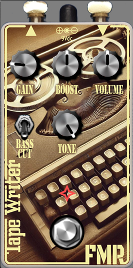

# Tape Writer

**Give Your Tone More Character.**

Inspired by the legendary Echoplex preamp, Tape Writer brings that sought-after warmth, presence and character to your guitar signal, with an additional JFET output boost for extra punch and drive.

Four dedicated neural models recreate the two-stage design, combining three models for the preamp stage with a dedicated JFET boost model. A 3-position bass-cut switch lets you fine-tune the low-end response, while Gain, Boost, Tone and Volume give you complete control over your sound.

From subtle tonal enhancement to rich, pushed tones, Tape Writer adds character without getting in the way.

**Explore. Craft. Find. Enjoy your own sound!**

This plugin models a real analog pedal that we developed.

Distributed as a free **Windows VST3** plugin by [FMR Labs](https://github.com/FMR-Labs). Built with **iPlug2**.

<p align="center">
  
</p>

> **Note:** FMR Labs is an independent personal project and is not affiliated with FMR Audio.

---

## Features

* 3 input filter selectable with lever switch
* Controls: **Gain**, **Boost**, **Tone**, **Volume**, **Bass cut**, **Bypass**
* Mono or stereo (`1-1`, `2-2`), independent processing per channel
* Input level LED around bypass foot switch (green / orange / red)
* Star-shaped activation LED
* Click-free channel switching (short mute fade)
* Runs at any host sample rate: the engine works at 48 kHz, with automatic resampling when the host runs at another rate. The resampler latency is reported to the host.
* Lightweight: small recurrent neural network per model, no allocation or lock on the audio thread

## Signal chain

```
Host (any fs, 1-2 ch)
 → [fs ≠ 48 kHz] resampling → 48 kHz
 → 1st neural model (driven by Gain and Selectable by Bass Cut)
 → Tone
 → 2nd neural model (driven by Boost)
 → Volume
 → [fs ≠ 48 kHz] resampling → host fs
```

## Level indicators

| Indicator | Measured | Green | Orange | Red |
|---|---|---|---|---|
| Input LED | Level after PreGain | below -9 dB | below -3 dB | above |

Input LED thresholds are relative to a 4.5 full scale.

---

## Installation (Windows)

> Binaries will be published on the **[Releases](../../releases)** page. Until then, there is nothing to download.

1. Download the latest `.zip` from the **[Releases](../../releases)** page. It contains the plugin, a `README_FMR_TapeWriter.txt` (installation, license, third-party notices) and the font license file.
2. Extract the `.vst3` file.
3. Copy it into your VST3 folder (usually `C:\Program Files\Common Files\VST3`).
4. Rescan plugins in your DAW.

---

## About this repository (source code notice)

This repository contains the **iPlug2 wrapper and UI** of Neural Preamp: plugin class, parameters, UI layout, resources and CMake project.

* **The DSP engine is closed source and not included.** `CMakeLists.txt`, `TapeWriter.cpp`, `TapeWriterDSP.cpp` and `TapeWriterGUI.cpp` reference it through `../FMR_Library/` (neural network inference, weights, EQ, resampler, pot curves, filters, and a custom UI control). **The project cannot be compiled from this repository alone.**
* **Images are not included** (the knob and background bitmaps). See [THIRD_PARTY.md](THIRD_PARTY.md) for their origin and licenses.
* It is published to share iPlug2 UI and parameter patterns, track issues and host documentation. Pre-compiled binaries will be distributed through GitHub Releases.

### Layout

| File | Role |
|---|---|
| `TapeWriter.h / .cpp` | Plugin class, parameters |
| `TapeWriterDSP.h / .cpp` | Plugin audio callback |
| `TapeWriterGUI.h / .cpp` | Plugin UI |
| `config.h` | iPlug2 plugin configuration (IDs, channels, UI size, resources) |
| `CMakeLists.txt` | iPlug2 CMake project (VST3 target) |
| `resources/` | Windows resources (`main.rc`, `resource.h`); images are not included |

### Building the wrapper structure (reference only)

Requires [iPlug2](https://github.com/iPlug2/iPlug2), CMake ≥ 3.14, a C++20 compiler, and the engine sources placed in `../FMR_Library/`:

```
cmake -B build -DIPLUG2_DIR=<path to iPlug2>
cmake --build build --config Release
```

---

## License

* **Source code in this repository** (iPlug2 UI and wrapper): [MIT License](LICENSE). The MIT license covers the code only. Fonts and images are not part of this repository and keep their own terms, see [THIRD_PARTY.md](THIRD_PARTY.md).
* **Compiled binaries (`.vst3`)**: **Freeware**. Free to use in both personal and commercial music productions. You may redistribute the original, unmodified archive, free of charge. Reverse engineering, decompiling, reselling, or redistributing modified binaries is prohibited.

*VST is a trademark of Steinberg Media Technologies GmbH.*
